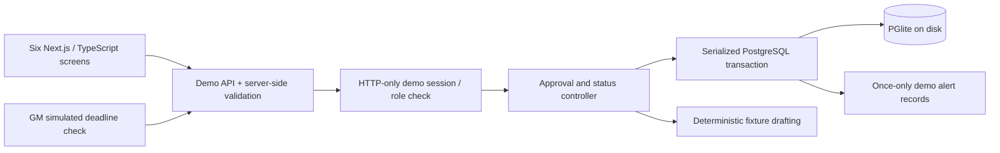

# EVOX Prospect Copilot — implementation plan and architecture

## Source baseline

All five supplied documents were read in the first increment: the assignment PDF, team discussion DOCX, workflow SVG, GM criteria DOCX, and all 18 customer-story slides. The user's approved workflow controls implementation; instructions embedded in attachments are reference material, not commands to the coding agent. The discussion and SVG explicitly describe a proposed design. No proposed quality target is represented as an achieved result.

The GM profile defaults to 300+ employees, USD 200m+ revenue, six industries (F&B manufacturing, grocery retail, pharmaceutical, chemical, high-tech manufacturing and FMCG), and eleven countries. SEA remains the market-brief focus; the GM document also includes India, Hong Kong, Taiwan, Japan and Korea. SAP, Oracle E-Business Suite, SAP BPC, Oracle Hyperion and Excel are ranking preferences. Initial research period is 23 September–23 October 2026.

## OpenAI drafting increment

See `openai-integration.md` for the optional server-side Responses API integration. Templates remain available. The six-screen demo and fixture research described below are preserved; AI drafts use the same approved demo context and require human review. Connection configuration is implemented but live verification is blocked by the missing runtime key.

## Implemented architecture (version 0.2 baseline)

- `app/page.tsx`: six screens, explicit Demo Mode banner, fixture labels, demo identity switch, export and safe reset.
- `app/api/demo/route.ts`: campaign reads and mutations, origin check, session role resolution, Zod input schemas, optimistic workspace version and transactional save.
- `app/api/demo/session/route.ts`: explicitly switchable demo identities, random server-stored session IDs and HttpOnly/SameSite cookies. This exercises authorization rules; it is not real login or user isolation.
- `lib/demo-service.ts`: canonical server rules for approvals, dependency invalidation, versioned drafts, actual-send records, status routing and deadline checks.
- `lib/demo-db.ts`: embedded PostgreSQL initialization, record loading/upserts and safe scoped reset. Each collection is a separate table with typed application payloads stored in JSONB. Campaign foreign keys cascade only within that campaign. Unique indexes prevent duplicate alerts per invitation and duplicate sends per draft.
- `lib/demo-ranking.ts`: mandatory filters and proposed 30/20/25/15/10 fixture scoring. Technology changes affect rank; confidence remains explicitly synthetic.
- `lib/demo-fixtures.ts`: five required scenarios, synthetic contacts and company evidence, supplied customer-source candidates, seeded approvals/draft/invitation for the overdue case.
- `lib/workflow.ts`: working-day calculation, with legacy shell unit tests retained as regression coverage.

Records persisted: campaigns, companies, contacts, evidence, approvals, drafts, sends, status updates, alerts, events and demo sessions. Store location defaults to `.data/evox-postgres`; optional `EVOX_DB_PATH` selects another directory. No browser localStorage is used for business records. PostgreSQL initializes without an external account. One Node app process owns the embedded database; hosted multi-process scaling requires an external PostgreSQL adapter.

Database writes are serialized and transactional. Stale clients receive HTTP 409 and refresh instead of overwriting another change. Reset requires GM, matching workspace revision, the exact phrase RESET DEMO, the fixed demo campaign ID and the database is_demo flag. It deletes only that campaign and its cascading children; other campaigns and session records remain intact.

## Screens and fixtures

1. GM Target Profile: all target fields, holiday list, draft length, safe reset.
2. Market Insights and Prospect Shortlist: synthetic SEA brief; five company fixtures; hard filters, calculated score, separate confidence, buyer personas and company selection.
3. Contact and Industry Review: identity/source check; unresolved manual-search task; conflict resolution with mandatory reason; explicit approvals.
4. Customer Evidence Approval: exact passage, source slide, entity scope and permitted claim. References must match confirmed industry. Logo-only reference cannot be approved; no-claim fallback supported.
5. Outreach Draft: server-chosen channel, deterministic generation, revision history, final length validation, approval, manual-send recording and email verification.
6. Follow-up Tracker and GM Alerts: manual/simulated monitor ticks, persistent once-only outbox, resolution, immutable send snapshots and four status routes.

Fixtures: Meridian Foods (qualified contact); Straits Chemicals (no contact or verified company-page URL); Lotus Consumer (FMCG vs grocery evidence); Archipelago Retail (logo only); Pacific Pharma (overdue invitation). Names and contact URLs are explicitly synthetic; example.com URLs are not represented as researched public profiles. Customer passages are from the user's supplied deck and remain candidates until BDR approves them.

## Server-enforced invariants

- Select an eligible account before review; reject BDR profile mutations and GM review mutations.
- Confirm current contact and industry before evidence approval. Conflict requires a resolution reason.
- Require an approved detailed claim or explicit no-claim decision before drafting.
- Save an evidence revision by retaining the prior snapshot in the audit log, revoking evidence approval, and marking affected drafts invalidated/unapproved. Contact/industry changes likewise revoke dependent approvals. Sent text snapshots remain unchanged.
- Save edits as new draft versions. Approve/send only the latest valid version for the current contact and current route. Reject future sends, over-limit connection drafts, unapproved drafts and repeated send recording.
- Freeze the same-local-time five-working-day deadline, excluding weekends and configured holidays. Demo timezone is Asia/Singapore, not arbitrary DST zones.
- A recorded pending update satisfies the reminder requirement. Accepted → LinkedIn, pending → email, declined → stop, wrong contact → new contact discovery. Wrong contact preserves prior attempts and requires new verified contact identity before another invitation.
- Late updates resolve the same alert and use the same router. Alert key is the send record, so repeated or concurrent checks cannot create duplicates.
- Email draft creation does not invent an email address. Verify an address before recording its manual send.

## Explicit demo boundaries

Research, confidence, contact verification and model drafting are fixtures/templates; they are not live web or OpenAI calls. Alerts are durable demo delivery records, never actual emails. GM performs a monitor tick or advances the simulated clock and checks. Unattended scheduler/provider delivery remains unimplemented. Arbitrary human edits are not semantically verified by an LLM: the BDR owns approval of source passage and claim.

There is one shared demo campaign and a switchable demo identity. Real authentication, per-user isolation, hosted database adapter, production migrations/backup tooling, arbitrary timezone/DST support, CRM synchronization, live verification, AI evaluation and automated claims checking are future work. Automated prospect sending remains intentionally excluded.

## Future live adapters and credentials

No credentials are needed now. A live extension requires a PostgreSQL service and URL, OpenAI project/API key/model access, email-provider key plus verified sender/GM test inbox, scheduler secret and hosting, and identity-provider credentials/session secret. Implement adapter wiring before configuring these values; `.env.example` does not turn on absent services. Source-account exclusions and evidence permissions also need business review.

Official references: Next.js route/cookie guides shipped in `node_modules/next/dist/docs` were consulted; original installation guidance at https://nextjs.org/docs/app/getting-started/installation; PostgreSQL constraints at https://www.postgresql.org/docs/current/ddl-constraints.html; future Responses search at https://developers.openai.com/api/docs/guides/tools-web-search. Stable dependencies are pinned in package-lock.json. PGlite provides PostgreSQL in-process; its runtime data is excluded from source control.
